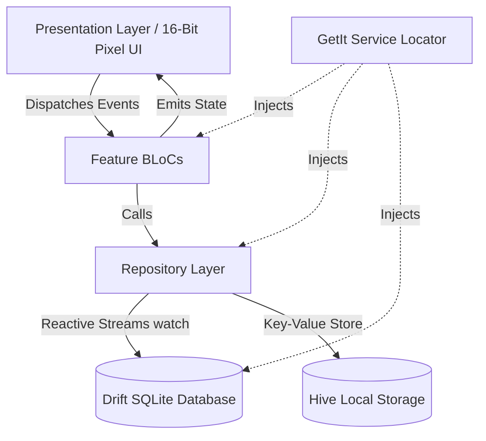

<div align="center">

# ⚔️ WorkXP (Pocket Quest) 🛡️
### *Gamified 16-bit Retro Pixel RPG Productivity Mobile App*
**แอปพลิเคชันบริหารจัดการงานและสร้างนิสัยในรูปแบบเกม RPG พิกเซล 16-บิต**

[](https://flutter.dev)
[](https://dart.dev)
[](https://bloclibrary.dev)
[](https://drift.simonbinder.eu)
[](https://autoroute.vercel.app)


---

[English](#-english) • [ภาษาไทย](#-ภาษาไทย) • [Architecture](#-architecture--สถาปัตยกรรม) • [Getting Started](#-getting-started--การเริ่มต้นใช้งาน)

---

</div>

## 🌐 English

### 📖 Overview
**WorkXP (Pocket Quest)** transforms everyday productivity into an engaging 16-bit retro pixel RPG. Turn real-life tasks into epic boss encounters, log daily habits to cast powerful MP buffs, conquer multi-chapter dungeon campaigns, and spend hard-earned gold coins at the Tavern marketplace for in-game gear or custom real-world rewards.

Architected according to the **FLDP Mobile Standard**, WorkXP delivers a zero-latency, 60fps reactive experience with enterprise-grade modularity, full offline persistence, and seamless bilingual localization.

---

### ✨ Key Features

- ⚔️ **Battle Hub (Quest & Boss Combat)**
  - Convert real-world tasks into quests across 5 difficulty ranks (F to S).
  - Inflict calculated attack damage, trigger critical hits, and enjoy floating combat numbers with screen-shake sensory effects.
  - Active **Focus Surge** combo multipliers rewarding consecutive quest completions.

- 🧪 **Habits & MP Skill Buffs**
  - Track positive and negative habits with instant Coin and MP economy adjustments.
  - Cast active RPG skill buffs: *Focus Surge* (damage boost), *Double EXP* (2x leveling speed), *Golden Touch* (coin drop multiplier), and *Shield of Discipline* (penalty absorption).

- ⏳ **Day Cycles, Ghost State & Revival**
  - Automated midnight rollover calculations punishing neglected daily quests with hero HP damage.
  - Fall into **Ghost State** upon HP exhaustion (with visual grayscale aura and rewards blocked).
  - Complete emergency **Revival Quests** to restore vitality and regain full combat capacity.

- 🗺️ **World Map & Dungeon Progression**
  - 5-Chapter campaign spanning from *Whispering Woods* to *Oblivion Citadel*.
  - Level-gated stages, boss bestiaries, and unique chapter loot drops.

- 🍻 **The Tavern Marketplace**
  - Spend gold coins on consumable potions, attribute boosters, and 16-bit retro sprite skins.
  - Create and redeem **Custom Real-World Rewards** (e.g., "30m Gaming Session", "Special Coffee Treat").

- 📊 **Hall of Fame & Analytics**
  - Interactive **FL Chart** data visualizations: EXP progression curves, 7-day damage graphs, habit consistency heatmaps, and a 6-axis attribute radar chart.
  - Offline leaderboard rankings and dynamic title unlocks based on hero achievements.

- 🛡️ **Hero Sanctuary & System Settings**
  - Allocate stat points across 6 core RPG attributes: **STR**, **INT**, **VIT**, **AGI**, **DEX**, and **LUK**.
  - Complete JSON backup export and import with cryptographic integrity verification.
  - Dynamic English/Thai language switching and customizable haptic/audio feedback.

---

## 🇹🇭 ภาษาไทย

### 📖 ภาพรวมโปรเจกต์
**WorkXP (Pocket Quest)** คือแอปพลิเคชันจัดการงานและพัฒนาตนเองที่เปลี่ยนกิจกรรมในชีวิตจริงให้กลายเป็นการผจญภัยในโลกแฟนตาซี 16-บิต สไตล์ Retro Pixel RPG เปลี่ยนภารกิจประจำวันให้เป็นการต่อสู้กับบอสสุดท้าทาย บันทึกนิสัยเพื่อสะสม MP และร่ายสกิลบัฟ ตะลุยด่านดันเจี้ยน และนำเหรียญทองที่ได้ไปแลกไอเทมหรือของรางวัลในชีวิตจริงที่โรงเตี๊ยม (The Tavern)

พัฒนาด้วยสถาปัตยกรรมระดับมาตรฐาน **FLDP Mobile Standard** ให้การทำงานลื่นไหล 60fps ตอบสนองแบบ Real-time ทำงานออฟไลน์สมบูรณ์แบบ และรองรับสองภาษา (ไทย/อังกฤษ) อย่างราบรื่น

---

### ✨ ฟีเจอร์เด่น

- ⚔️ **ศูนย์รวมการต่อสู้ (Battle Hub)**
  - แปลงงานจริงเป็นเควสต์ 5 ระดับความยาก (F ถึง S Rank)
  - ระบบคำนวณดาเมจโจมตีบอส, การติดคริติคอล, ตัวเลขดาเมจลอย (Floating Combat Text) พร้อมระบบสั่นหน้าจอ
  - ระบบคอมโบ **Focus Surge** เพิ่มพลังโจมตีต่อเนื่องเมื่อเคลียร์งานติดต่อกัน

- 🧪 **ระบบนิสัยและสกิลบัฟ (Habits & MP Engine)**
  - บันทึกนิสัยดี/ไม่ดี พร้อมคำนวณเหรียญและค่า MP แบบ Real-time
  - ร่ายสกิลบัฟทรงพลัง: *Focus Surge* (เพิ่มดาเมจ), *Double EXP* (EXP x2), *Golden Touch* (เหรียญ x1.5) และ *Shield of Discipline* (โล่ป้องกันดาเมจ)

- ⏳ **ระบบรีเซ็ตข้ามวัน, สถานะวิญญาณ และการชุบชีวิต**
  - คำนวณดาเมจลงโทษอัตโนมัติเมื่อละเลย Daily Quests หลังเที่ยงคืน
  - หาก HP หมดจะเข้าสู่ **Ghost State (ร่างวิญญาณ)** ทำให้จอเป็นโทนขาวดำและถูกระงับการรับรางวัล
  - ปลดล็อกเควสต์กู้ชีพพิเศษ (**Revival Quest**) เพื่อฟื้นคืนชีพกลับมาต่อสู้อีกครั้ง

- 🗺️ **แผนที่โลกและดันเจี้ยน (World Map & Dungeon)**
  - ตะลุยด่าน 5 แชปเตอร์ ตั้งแต่ *Whispering Woods* จนถึง *Oblivion Citadel*
  - ปลดล็อกด่านตามเลเวลของฮีโร่ สมุดภาพบอส (Bestiary) และไอเทมดรอปเฉพาะด่าน

- 🍻 **ตลาดโรงเตี๊ยม (The Tavern)**
  - ใช้เหรียญทองซื้อยาฟื้นฟู, บูสเตอร์สเตตัส และสกินตัวละครพิกเซลสุดเท่
  - สร้างและแลก **รางวัลในชีวิตจริง** (เช่น "เล่นเกม 30 นาที", "ดื่มกาแฟแก้วโปรด")

- 📊 **หอเกียรติยศและการวิเคราะห์ (Hall of Fame & Analytics)**
  - กราฟสถิติวิเคราะห์ด้วย **FL Chart**: กราฟเส้น EXP, กราฟแท่งดาเมจรายสัปดาห์, Heatmap การทำนิสัย และ Radar Chart สเตตัส 6 ทิศทาง
  - กระดานจัดอันดับ (Leaderboard) และระบบฉายา (Titles) ตามความสำเร็จ

- 🛡️ **วิหารฮีโร่และการตั้งค่า (Hero Sanctuary)**
  - อัปเกรดค่าสเตตัส 6 สาย: **STR**, **INT**, **VIT**, **AGI**, **DEX**, **LUK**
  - ระบบสำรองและกู้คืนข้อมูลด้วย JSON Backup พร้อมระบบตรวจสอบความถูกต้อง
  - สลับภาษาไทย-อังกฤษได้ทันที พร้อมตั้งค่าระบบสั่นและเสียงเอฟเฟกต์

---

## 🏛️ Architecture / สถาปัตยกรรม

WorkXP follows the **FLDP Mobile Standard Architecture**, strictly adhering to Feature-First Vertical Slices and Clean Architecture principles:

```
lib/
├── config/                  # Environment & App Configurations (.env)
├── domain/                  # Pure Domain Entities, Drift SQLite & Repositories
│   ├── datasource/          # Drift Database (7 Tables) & Hive Storage
│   ├── models/              # Immutable Entities & Math Engine
│   └── repositories/        # Reactive Repository Implementations
├── feature/                 # Vertical Feature Slices
│   ├── battle_hub/          # Quests, Dailies, Habits, Boss, Ghost & Revival BLoCs
│   ├── dungeon/             # World Map & Chapter Progression
│   ├── tavern/              # Marketplace, Consumables & Custom Rewards
│   ├── analytics/           # Charts & Leaderboard
│   └── hero_sanctuary/      # Vitals, Attributes & Settings
├── i18n/                    # Feature-Divided Multi-Folder ARBs (en.arb, th.arb)
├── router/                  # AutoRoute Declarative Routing & 5-Tab Dashboard
├── shared/                  # 16-bit Retro Pixel Design System & Theme Tokens
├── locator.dart             # Centralized GetIt Dependency Injection
└── main.dart                # Application Entry Point
```

### 🧩 Architecture Highlights


---

## 🚀 Getting Started / การเริ่มต้นใช้งาน

### 📋 Prerequisites
- **Flutter SDK**: `>= 3.29.0`
- **Dart SDK**: `>= 3.7.0`
- **Platform**: Android / iOS / macOS / Windows / Linux

### 🛠️ Installation Steps

1. **Clone the Repository**
   ```bash
   git clone https://github.com/Theeraphat-S/workxp-mobile.git
   cd workxp-mobile
   ```

2. **Install Dependencies**
   ```bash
   flutter pub get
   ```

3. **Configure Environment Variables**
   ```bash
   cp .env.example .env
   ```

4. **Generate Code & Translations**
   ```bash
   # Generate Drift tables, AutoRoute routes, and Hive adapters
   dart run build_runner build --delete-conflicting-outputs

   # Compile modular ARB dictionaries into i18n
   dart run tool/generate_i18n.dart
   ```

5. **Run the Application**
   ```bash
   flutter run
   ```

---

## 📄 License & Attribution

Developed with ❤️ as a showcase of the **FLDP Mobile Standard Architecture**.  
Crafted with 16-bit retro love for productive heroes worldwide.

