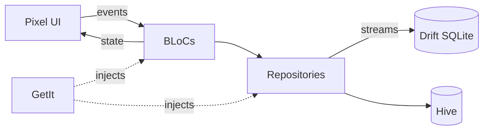
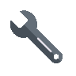

<div align="center">


# WorkXP (Pocket Quest)

**16-bit pixel RPG that turns your tasks into boss fights.**<br/>
แอปจัดการงานและสร้างนิสัยในรูปแบบเกม RPG พิกเซล 16-บิต

[](https://flutter.dev)
[](https://dart.dev)
[](https://bloclibrary.dev)
[](https://drift.simonbinder.eu)
[](https://pub.dev/packages/hive)
[](https://pub.dev/packages/auto_route)
[](https://pub.dev/packages/get_it)
[](https://pub.dev/packages/audioplayers)

[Overview](#overview) • [Features](#features) • [Architecture](#architecture) • [Getting Started](#getting-started)

</div>

---

##  Overview

Finish real tasks to damage **Bosses**, log **Habits** for MP buffs, clear **Dungeon** chapters, and spend **Coins** at **The Tavern**. Fully offline, 60fps, Thai/English, with 16-bit chiptune audio.

> ทำงานจริงเพื่อโจมตีบอส สะสม MP จากนิสัยดี ตะลุยดันเจี้ยน แล้วนำเหรียญไปแลกรางวัล — ทำงานออฟไลน์ 100%

---

##  Features

| | Feature | What it does |
| :-: | :-- | :-- |
|  | **Battle Hub** | Quests ranked **E–S** deal instant damage to the Boss. Collapsible boss bar, quick-add `+` sheet, live tab badges. |
|  | **Chiptune Audio** | 8 SFX triggers + per-tab BGM. Separate toggles for BGM, SFX and haptics. |
|  | **Habits & MP Buffs** | `[+]` / `[-]` habit logging. Spend MP on *Double EXP*, *Boss Freeze*, *Focus Surge*. |
|  | **Ghost State & Revival** | Missed Daily Quests hurt your Hero at midnight. HP 0 = Ghost State; revive via **Revival Quest** or *Elixir of Life*. |
|  | **World Map** | 4 level-gated chapters, from *Slime Forest* to *Volcano Peak*, with a boss bestiary. |
|  | **The Tavern** | Buy potions, shields and skins — or redeem your own **Custom Rewards** (e.g. "50 Coins = Boba Tea"). |
|  | **Hall of Fame** | EXP curve, weekly damage, habit heatmap, attribute radar, achievements. |
|  | **Hero Sanctuary** | Allocate **STR / INT / AGI / VIT / WIS**, JSON backup/restore, Thai–English switch. |

---

##  Architecture

Feature-first vertical slices on the **FLDP Mobile Standard**.

```
lib/
├── core/          # SensoryService (SFX/BGM/haptics), DayCycleService, theme
├── domain/        # Entities, combat math, Drift DB, repositories
├── feature/       # battle_hub · dungeon · tavern · analytics · hero_sanctuary
├── i18n/          # en.arb / th.arb per feature
├── router/        # AutoRoute, 5-tab dashboard
├── shared/        # 16-bit shared widgets
├── locator.dart   # GetIt DI
└── main.dart
```



---

##  Getting Started

**Requires** Flutter `>= 3.38.4` · Dart `>= 3.11.3`

```bash
git clone https://github.com/Theeraphat-S/workxp-mobile.git && cd workxp-mobile
flutter pub get
cp .env.example .env
```

```bash
dart run build_runner build --delete-conflicting-outputs   # Drift, routes, adapters
dart run tool/generate_i18n.dart                           # i18n from ARBs
dart run tool/generate_audio_assets.dart                   # 16-bit SFX/BGM
```

```bash
flutter analyze && flutter test
flutter run
```

---

<div align="center">

 Built with the **FLDP Mobile Standard**, for productive heroes.

<sub>Animated icons by <a href="https://lordicon.com/">Lordicon.com</a></sub>

</div>
