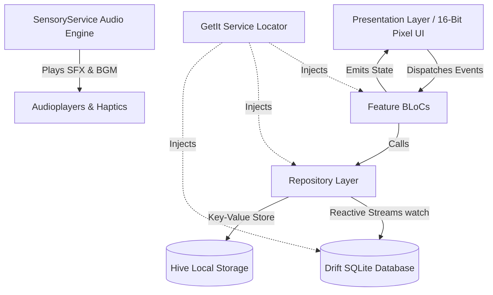

<div align="center">

# ⚔️ WorkXP (Pocket Quest) 🛡️
### *16-Bit Retro Pixel Fantasy RPG Productivity Mobile App*
**แอปพลิเคชันบริหารจัดการงานและสร้างนิสัยในรูปแบบเกม RPG พิกเซล 16-บิต**

[](https://flutter.dev)
[](https://dart.dev)
[](https://bloclibrary.dev)
[](https://drift.simonbinder.eu)
[](https://autoroute.vercel.app)
[](https://pub.dev/packages/audioplayers)

---

[English](#-english) • [ภาษาไทย](#-ภาษาไทย) • [Architecture](#-architecture--สถาปัตยกรรม) • [Getting Started](#-getting-started--การเริ่มต้นใช้งาน)

---

</div>

## 🌐 English

### 📖 Overview
**WorkXP (Pocket Quest)** transforms everyday productivity into an authentic 16-bit retro fantasy RPG adventure. Convert real-world tasks into quests that deal strike damage against Dungeon Bosses, log daily habits to cast magical MP buffs, traverse chapter-based dungeon campaigns, and spend earned Coins at The Tavern marketplace for consumables or custom real-world rewards.

Built according to the enterprise-grade **FLDP Mobile Standard**, WorkXP provides a 60fps zero-latency experience with reactive Drift SQLite streams, full offline persistence, hybrid legible typography, and an immersive 16-bit chiptune audio soundtrack.

---

### ✨ Key Features

- ⚔️ **Battle Hub (Streamlined Combat & Activity Center)**
  - Convert real-world tasks into **Quests** across 6 difficulty ranks (**E, D, C, B, A, S**) dealing instant calculated damage to the active **Boss**.
  - **Dynamic Collapsible Boss Header**: Seamlessly collapse the large Boss Encounter card into a compact **Mini Battle Bar** to reclaim 80% screen space for task management.
  - **Contextual Quick-Add FAB**: Tap the `+` button for a 2-level bottom sheet featuring **Quick Mode** (1-tap Attribute chips & smart default Rank D) and **Advanced Mode** (custom ranks, due dates, descriptions).
  - **Category Tab Badges**: Real-time counter badges for pending Quests, Daily Quests, and Habits.
  - Zero-latency optimistic strike updates with floating combat numbers and sensory shake feedback.

- 🎵 **16-Bit Chiptune Audio & Contextual BGM**
  - **8 Custom 16-Bit SFX Triggers**: Retro synthesized sword slashes, critical strikes, coin chimes, hero hurt, level-up fanfares, victory chimes, and magic buff casts.
  - **Contextual Background Music (BGM)**: Distinct chiptune themes for *Battle Hub* (Heroic Adventure), *Dungeon Map* (Mysterious Expedition), *The Tavern* (Cozy Lofi Chiptune), and *Sanctuary* (Calming Melody).
  - Independent audio settings in Hero Sanctuary with dedicated toggles for BGM, SFX, and tactile haptics.

- 🧪 **Habits & MP Skill Buffs**
  - Instant `[ + ]` and `[ - ]` steppers on habit cards to log positive behaviors and discipline slips.
  - Cast tactical RPG skill buffs using accumulated MP: *Double EXP Scroll*, *Boss Freeze / Stun* (shields from midnight penalty), and *Focus Surge* (+50% attack damage).

- ⏳ **Day Cycles, Ghost State & Revival Quest**
  - Automated midnight reset calculations: unfinished Daily Quests cause Boss counter-attacks, draining Hero HP.
  - **Ghost State**: When Hero HP reaches 0, the app adopts a desaturated grayscale mood, suspending EXP and Coin gains.
  - Undertake emergency **Revival Quests** (e.g. drink water, take a walk) or use an *Elixir of Life* from The Tavern to revive.

- 🗺️ **World Map & Dungeon Progression**
  - Traverse thematic chapters: *Slime Forest*, *Goblin Keep*, *Shadow Crypt*, and *Volcano Peak*.
  - Level-gated chapter progression, boss bestiary cards, and chapter-specific rewards.

- 🍻 **The Tavern Marketplace**
  - Spend earned Coins on game consumables (*Health Potions*, *Streak Shields*, *EXP Tonics*, *Elixirs of Life*) and cosmetic avatar skins.
  - Create and redeem **Custom Real-Life Rewards** (e.g. "50 Coins for Boba Tea", "40 Coins for 1h Gaming").

- 📊 **Hall of Fame & Analytics**
  - High-performance **FL Chart** visualizations: EXP progression curve, 7-day boss damage bar chart, 16-bit habit consistency heatmap, and 5-attribute radar chart.
  - Simulated offline leaderboard and lifetime achievement badges.

- 🛡️ **Hero Sanctuary & System Settings**
  - Allocate earned stat points across 5 core attributes: **STR**, **INT**, **AGI**, **VIT**, and **WIS**.
  - Complete JSON backup export and import with cryptographic integrity verification.
  - Bilingual localization (Thai / English) and **Hybrid Typography** (Prompt/Kanit for crisp text readability + Press Start 2P/Silkscreen for retro RPG HUD stats).

---

## 🇹🇭 ภาษาไทย

### 📖 ภาพรวมโปรเจกต์
**WorkXP (Pocket Quest)** คือแอปพลิเคชันบริหารจัดการงานและพัฒนาตนเองที่เปลี่ยนกิจกรรมในชีวิตจริงให้กลายเป็นการผจญภัยในโลกแฟนตาซี 16-บิต สไตล์ Retro Pixel RPG เปลี่ยนภารกิจประจำวันให้เป็นการต่อสู้กับบอสสุดท้าทาย บันทึกนิสัยเพื่อสะสม MP และร่ายสกิลบัฟ ตะลุยด่านดันเจี้ยน และนำเหรียญทองที่ได้ไปแลกไอเทมหรือของรางวัลในชีวิตจริงที่โรงเตี๊ยม (The Tavern)

พัฒนาด้วยสถาปัตยกรรมระดับมาตรฐาน **FLDP Mobile Standard** ให้การทำงานลื่นไหล 60fps ตอบสนองแบบ Real-time ทำงานออฟไลน์สมบูรณ์แบบ รองรับสองภาษา (ไทย/อังกฤษ) และมีระบบเสียง 16-Bit Chiptune SFX/BGM ครบวงจร

---

### ✨ ฟีเจอร์เด่น

- ⚔️ **ศูนย์รวมการต่อสู้ (Battle Hub & กิจกรรม)**
  - แปลงงานจริงเป็นเควสต์ 6 ระดับความยาก (**E, D, C, B, A, S**) โจมตีดันเจี้ยนบอสแบบเรียลไทม์
  - **ระบบพับเก็บ Boss Header (Collapsible Boss)**: ย่อการ์ดบอสขนาดใหญ่ให้เป็น **Mini Battle Bar** บางๆ เพื่อเพิ่มพื้นที่แสดงรายการงานได้เต็มตาถึง 80%
  - **ปุ่มสร้างงานด่วน (Contextual Quick-Add FAB)**: ปุ่ม `+` ลอย เปิด Bottom Sheet แบบ 2 ระดับ: **Quick Mode** (ชิปเลือก Attribute ใน 1 แตะ + ค่าเริ่มต้น Rank D) และ **Advanced Mode** (ปรับ Rank, Due Date, บันทึกย่อ)
  - **Category Tab Badges**: ตัวเลขนับจำนวนเควสต์ค้างของวันแบบเรียลไทม์
  - ตัวเลขดาเมจลอย (Floating Combat Numbers) และเอฟเฟกต์สั่นจอแบบ Zero Latency

- 🎵 **ระบบเสียง 16-Bit Chiptune SFX & เพลงประกอบ BGM**
  - **เสียงเอฟเฟกต์ 8 รูปแบบ**: เสียงฟันดาบ, ดาเมจคริติคอล, เสียงเหรียญกระดิ่ง 8-bit, เสียงเจ็บ, เลเวลอัป, ชนะบอส, ร่ายบัฟเวทมนตร์ และเสียงคลิกปุ่ม UI
  - **เพลงประกอบ BGM ประจำแต่ละแท็บ**: *Battle Hub* (ธีมผจญภัยเร้าใจ), *Dungeon Map* (ธีมสำรวจลึกลับ), *The Tavern* (ธีม Lofi Chiptune ผ่อนคลาย) และ *Sanctuary* (ธีมสงบสำหรับหน้าเมนู)
  - ควบคุมเปิด/ปิดเสียงแยกอิสระระหว่าง BGM, SFX และระบบสั่น Haptics ในหน้า Hero Sanctuary

- 🧪 **ระบบนิสัยและสกิลบัฟ (Habits & MP Engine)**
  - ปุ่ม `[ + ]` และ `[ - ]` บนการ์ดนิสัย แตะบันทึกความถี่ได้ทันที 1 คลิก
  - ร่ายสกิลบัฟ RPG จากค่า MP: *Double EXP Scroll* (EXP 2 เท่า), *Boss Freeze / Stun* (หยุดบอสข้ามวัน), และ *Focus Surge* (เพิ่มพลังโจมตี +50%)

- ⏳ **ระบบรีเซ็ตข้ามวัน, สถานะวิญญาณ และการชุบชีวิต**
  - คำนวณดาเมจลงโทษอัตโนมัติเมื่อทำ Daily Quests ไม่ครบหลังเที่ยงคืน
  - หาก HP เหลือ 0 จะเข้าสู่ **Ghost State (สภาวะวิญญาณ)** หน้าจอเปลี่ยนเป็นโทนขาว-ดำหม่น และระงับการรับ EXP/Coins
  - ปลดล็อกเควสต์กู้ชีพพิเศษ (**Revival Quest**) เช่น ดื่มน้ำ 1 แก้ว หรือเดินพักผ่อน หรือใช้ยา *Elixir of Life* เพื่อฟื้นคืนชีพ

- 🗺️ **แผนที่โลกและดันเจี้ยน (World Map & Dungeon)**
  - ตะลุยด่าน 4 แชปเตอร์: *Slime Forest*, *Goblin Keep*, *Shadow Crypt* และ *Volcano Peak*
  - ปลดล็อกด่านตามเลเวล สมุดภาพข้อมูลบอส (Bestiary) และรางวัลประจำแชปเตอร์

- 🍻 **ตลาดโรงเตี๊ยม (The Tavern Marketplace)**
  - ใช้เหรียญ Coin ซื้อยาฟื้นฟู (*Health Potion*, *Streak Shield*, *EXP Tonic*, *Elixir of Life*) และสกินตัวละครพิกเซล
  - สร้างและแลก **รางวัลในชีวิตจริง (Custom Real-Life Rewards)** (เช่น "50 Coins สำหรับชานมไข่มุก", "40 Coins สำหรับเล่นเกม 1 ชม.")

- 📊 **หอเกียรติยศและการวิเคราะห์ (Hall of Fame & Analytics)**
  - กราฟสถิติวิเคราะห์ด้วย **FL Chart**: กราฟเส้น EXP, กราฟแท่งดาเมจรายสัปดาห์, Heatmap ความสม่ำเสมอของนิสัย และ Radar Chart สเตตัส 5 ทิศทาง
  - กระดานจัดอันดับจำลอง (Simulated Leaderboard) และปลดล็อกฉายาฮีโร่ตามความสำเร็จ

- 🛡️ **วิหารฮีโร่และการตั้งค่า (Hero Sanctuary)**
  - อัปเกรดค่าสเตตัส 5 สาย: **STR**, **INT**, **AGI**, **VIT**, **WIS**
  - สำรองและกู้คืนข้อมูลด้วย JSON Backup ที่ปลอดภัย
  - สลับภาษาไทย-อังกฤษได้ทันที พร้อมระบบฟอนต์ **Hybrid Typography** ที่อ่านภาษาไทยได้คมชัด สบายตา สระไม่ซ้อนทับ

---

## 🏛️ Architecture / สถาปัตยกรรม

WorkXP adheres to the **FLDP Mobile Standard Architecture** with Feature-First Vertical Slices and Clean Architecture principles:

```
lib/
├── config/                  # Environment variables (.env) & constants
├── core/
│   ├── services/            # SensoryService (16-bit SFX, BGM, Haptics) & DayCycleService
│   └── theme/               # PixelColors, PixelTypography, PixelTheme
├── domain/                  # Pure Domain Entities, Drift SQLite & Repositories
│   ├── datasource/          # Drift Database (7 Tables) & Hive Storage
│   ├── models/              # Immutable RPG Entities & Combat Math
│   └── repositories/        # Reactive Stream Repository Implementations
├── feature/                 # Vertical Feature Slices
│   ├── battle_hub/          # Quests, Dailies, Habits, Boss, Quick-Add & Mini-Bar
│   ├── dungeon/             # World Map, Chapters & Bestiary
│   ├── tavern/              # Marketplace, Consumables & Custom Rewards
│   ├── analytics/           # FL Charts & Simulated Leaderboard
│   └── hero_sanctuary/      # Hero Vitals, Attributes, Skins, Titles & Settings
├── i18n/                    # Feature-Divided Multi-Folder ARBs (en.arb, th.arb)
├── router/                  # AutoRoute Declarative Routing & 5-Tab Dashboard
├── shared/                  # 16-Bit Shared Widgets (Buttons, Cards, Badges, Sprites)
├── locator.dart             # Centralized GetIt Dependency Injection
└── main.dart                # Application Entry Point
```

### 🧩 Architecture Highlights


---

## 🚀 Getting Started / การเริ่มต้นใช้งาน

### 📋 Prerequisites
- **Flutter SDK**: `>= 3.29.0`
- **Dart SDK**: `>= 3.7.0`
- **Platform**: Android / iOS / macOS / Windows / Linux

### 🛠️ Installation Steps

1. **Clone the Repository**
   ```bash
   git clone https://github.com/Theeraphat-S/workxp-mobile.git
   cd workxp-mobile
   ```

2. **Install Dependencies**
   ```bash
   flutter pub get
   ```

3. **Configure Environment Variables**
   ```bash
   cp .env.example .env
   ```

4. **Generate Code, Audio Assets & Translations**
   ```bash
   # Generate Drift SQLite schema, AutoRoute routes, and Hive adapters
   dart run build_runner build --delete-conflicting-outputs

   # Compile modular ARB dictionaries into i18n
   dart run tool/generate_i18n.dart

   # Synthesize 16-bit retro chiptune SFX and BGM audio files
   dart run tool/generate_audio_assets.dart
   ```

5. **Run Tests & Verify**
   ```bash
   flutter analyze
   flutter test
   ```

6. **Run the Application**
   ```bash
   flutter run
   ```

---

## 📄 License & Attribution

Developed with ❤️ as a showcase of the **FLDP Mobile Standard Architecture**.  
Crafted with 16-bit retro love for productive heroes worldwide.
